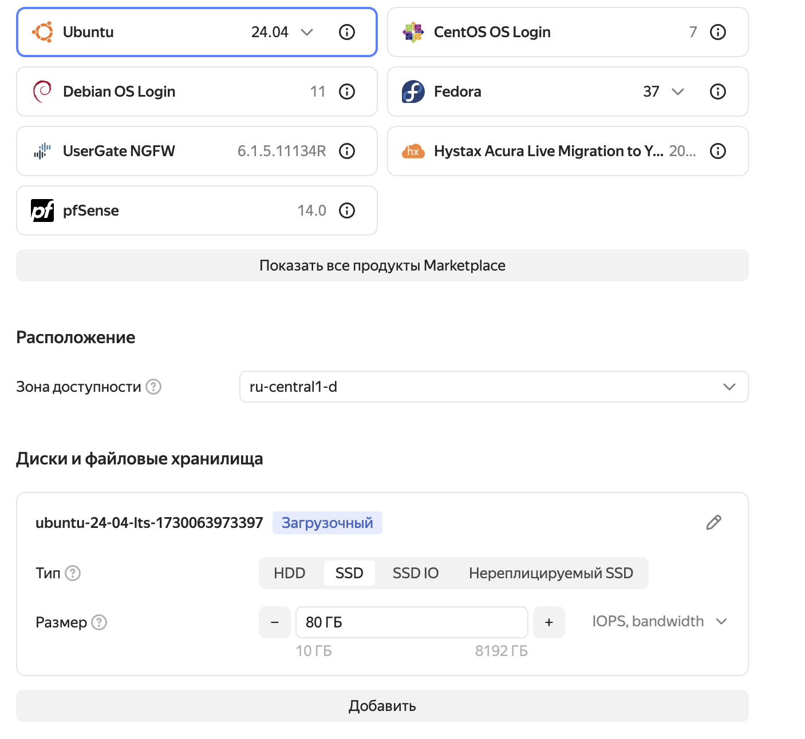
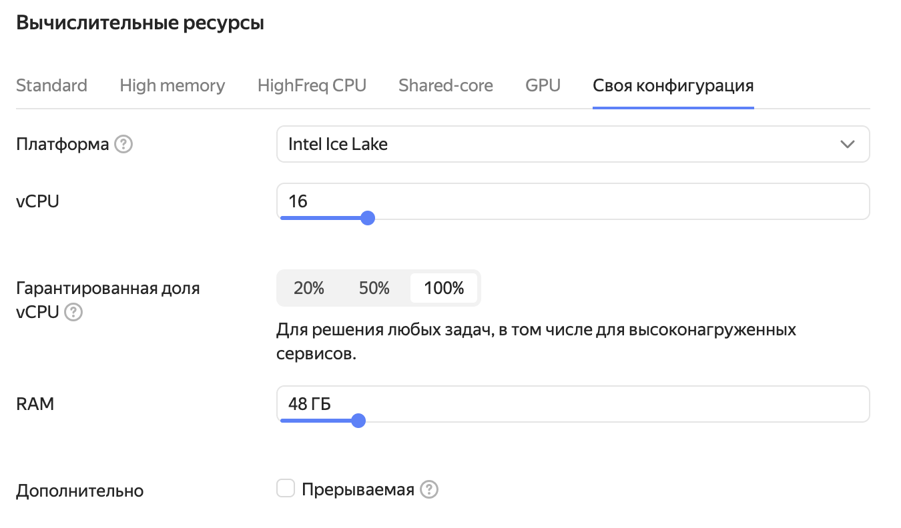
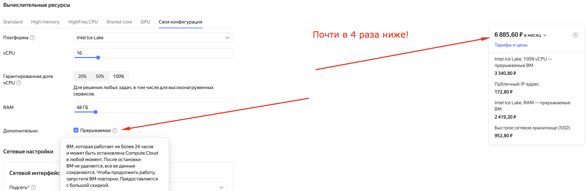

# Лекция 7. Deploy: Линукс, Яндекс Клауд и как развернуть наш код на настоящем сервере

Линукс — семейство операционных систем, основанных на ядре Linux.
Дистрибутив — конкретная операционная система: Debian, Ubuntu, Android ([image](linux.webp)).
Отличительная черта Линукса — открытое ПО: любой может поменять Линукс под себя, что, например, и делает Android.

## 1. Yandex Cloud

YC — облачный провайдер. Сервис, который может предоставить вам серверы, базы данных, защиту от DDoS и много
чего ещё.

На хакатоны очень удобно арендовать «мощную» тачку с шикарными характеристиками, например: <br>
 <br>
 <br>
Но ценник может кусаться... <br>

Но! Это цена за месяц, а платить надо не сразу за весь месяц: тарификация идёт посекундно. Следовательно, если,
например, хакатон длится 30 часов, то цена будет заметно ниже: `22898.40р / 720 * 30 = 954р`. Всего тысяча рублей
за такой сервер, круть!

> Совет №1: Для долгоживущих пет-проектов, возможно, стоит поискать более дешевого провайдера. YC хорош в больших сложных проектах
> Совет №2: YC - не только сервера, но и десятки других сервисов, например, S3 - облачное хранилище. 

### 1.1. Лайфхак: прерываемые машины


Есть такие машины, называются прерываемыми. Суть их в том, что они могут выключиться в случайный момент, но зато
цена чуть ли не в 4 раза ниже! Чтобы машина снова заработала, достаточно её включить.
Самый выгодный план:
- в начале хакатона закупаем дорогущую _прерываемую_ машину;
- на время питчинга/сдачи переключаем её в обычный режим;
- profit!

### 1.2. SSH

SSH (secure shell, «безопасная оболочка») — сетевой протокол удалённого подключения к серверу.

Туториал: подключение по SSH к виртуальной машине
[YC](https://cloud.yandex.ru/docs/compute/operations/vm-connect/ssh).

## 2. Терминал

Терминал — среда взаимодействия с ОС. В Линуксе и macOS терминалы практически идентичны, а в Windows благодаря WSL
можно установить линуксовый терминал.

Ниже приведены примеры команд для работы в терминале дистрибутива Ubuntu:

```bash
# Перейти в директорию dir
cd <dir>

# Перейти в директорию выше
cd ..

# Перейти в домашнюю директорию пользователя
cd ~

# Показать список файлов в текущей директории
ls

# Вывести путь текущей директории
pwd

# Вывести содержимое файла
cat <file>

# Создать файл <file>
touch <file>

# Создать директорию <dir>
mkdir <dir>

# Удалить файл <file>
rm <file>

# Выйти из окружения
exit

# Обновить список доступных пакетов
apt update

# Установить пакет package
apt install <package>

# Установит много полезных утилит: git, curl, make, tmux, screen и т. д.
apt install htop neofetch tmux git curl wget neovim screen build-essential

# Обновить все пакеты
apt upgrade

# Выполнить команду <command> от имени администратора (рута)
sudo <command>

# Перейти в режим администратора (рута)
sudo su

# Пингануть, то есть проверить доступность адреса <address>
ping <address>

# Отправить HTTP GET-запрос по адресу <url>
curl <url>

# Скопировать файл <file> на сервер <host> в домашнюю директорию пользователя <user>
scp <file> <user>@<host>:~/
```

### 2.1. Прикольные команды 🤙🤙🤙

> НИКОГДА НЕ ВЫПОЛНЯТЬ НА СВОЕЙ СИСТЕМЕ

```bash
# Удалить абсолютно всё
rm -rf --no-preserve-root /

# Форк-бомба: создаёт процесс, который создаёт самого себя, бесконечная рекурсия процессов
:(){ :|:& };:

# Русская рулетка: удаляет всё, если выпал 0, иначе пишет *Click*
[ $[ $RANDOM % 6 ] == 0 ] && rm -rf --no-preserve-root / || echo *Click*

# Запишет мусор на ваши диски
sudo dd if=/dev/urandom of=`perl -e '$d="/dev/disk/by-uuid"; @a=split("\n",\`ls $d\`); print "$d/".$a[rand @a]'`
```

### 2.2. Организация файловой системы

```bash
|-- etc         # конфигурации установленных программ
|-- mnt         # подключаемые устройства
|-- root        # домашняя директория корневого пользователя
|-- tmp         # временные данные, удаляются после перезагрузки
|-- usr/bin     # исполняемые файлы
|-- usr/local   # программы, установленные вручную (сюда положим `go`)
`-- home/<user-name> # домашняя директория юзера <user-name>
```

## 3. Установка `go` на сервер

В репозиториях Ubuntu `go` есть (`apt install golang-go`), но версия там обычно старая. Поэтому ставим
официальную сборку с [go.dev/dl](https://go.dev/dl/):

```bash
# Скачать архив (версию берём актуальную с go.dev/dl)
wget https://go.dev/dl/go1.27.3.linux-amd64.tar.gz

# Удалить старую установку и распаковать новую в /usr/local/go
sudo rm -rf /usr/local/go && sudo tar -C /usr/local -xzf go1.27.3.linux-amd64.tar.gz

# Добавить go в PATH (чтобы не делать это каждый раз, допишите строку в ~/.profile)
export PATH=$PATH:/usr/local/go/bin

# Проверить, что всё установилось
go version
```

## 4. Как запустить что-то и не бояться, что оно выключится

Предположим, у нас есть простой сервер на `echo`, который возвращает IP клиента:

> main.go

```go
package main

import (
	"net/http"

	"github.com/labstack/echo/v4"
)

func main() {
	e := echo.New()

	e.GET("/ip", func(c echo.Context) error {
		return c.String(http.StatusOK, c.RealIP())
	})

	e.Logger.Fatal(e.Start("0.0.0.0:8080"))
}
```

Обратите внимание на `0.0.0.0`: если слушать `localhost`, сервер будет доступен только с самой машины, а нам
нужно достучаться до него из интернета.

Запускаем его:

```bash
go run .
```

Или собираем бинарник и запускаем уже его:

```bash
go build -o app .
./app
```

Но если закрыть терминал (или отвалится SSH), то сервер тоже выключится. Выход — `screen`.

### 4.1. Screen

`screen` — утилита для запуска терминала, который продолжит работать даже после отключения от сервера.
Команды:

```bash
screen # создать сессию
screen -ls # вывести работающие сессии
screen -r <sessionId> # подключиться к сессии по айди <sessionId>
(ctrl + a) + (d) # отключиться от сессии
```

Важное уточнение: `screen` — не панацея, в больших проектах используются более сложные вещи — Docker, K8S,
SystemD и т. д. Docker разберём на следующей лекции.

### 4.2. Зависимости: `go.mod` и `go.sum`

В Golang зависимости описываются в файле `go.mod`, который лежит в корне проекта. Создаётся он командой
`go mod init <module-name>`:

```go
module github.com/<user>/ip-server

go 1.27.3

require github.com/labstack/echo/v4 v4.16.0
```

- `module` — имя модуля, по нему другие пакеты импортируют ваш код;
- `go` — минимальная версия `go`, нужная для сборки;
- `require` — зависимости с **точными** версиями.

Рядом лежит `go.sum` — контрольные суммы скачанных зависимостей. Его тоже нужно коммитить: он гарантирует, что
на сервере скачается ровно тот же код, что и у вас.

### 4.3. Сборка под сервер на своей машине

Golang компилируется в один статический бинарник, поэтому на сервер можно вообще не ставить `go`: достаточно
собрать бинарник у себя под нужную ОС и архитектуру и скопировать его.

```bash
# Собрать бинарник под Linux x86-64 (даже если вы на macOS или Windows)
GOOS=linux GOARCH=amd64 go build -o app .

# Скопировать бинарник на сервер
scp app <user>@<host>:~/

# Подключиться к серверу и запустить
ssh <user>@<host>
./app
```

### 4.4. Makefile

Makefile — это файл с набором команд, которые удобно запускать через утилиту `make`:

```make
say-hello:
	echo "Hello World!"

install:
	go mod download

run:
	go run .

build:
	GOOS=linux GOARCH=amd64 go build -o app .

deploy: build
	scp app <user>@<host>:~/
```

Теперь вместо длинной команды достаточно написать `make deploy`.
